

<h1 align="center">Ladle</h1>

<h3 align="center">Good food, picked up. Not thrown out.</h3>

  

Ladle connects **restaurants** that have good food left over at the end of the day with **food banks** nearby that can use it. A restaurant posts what it has in about a minute. A food bank sees it on a list and a map, claims it, and either collects it or asks a **volunteer driver** to bring it over. Everyone can see what has been rescued along the way.

It's free for restaurants and food banks, and it's built for the phones and tablets they already have in the kitchen and the warehouse.

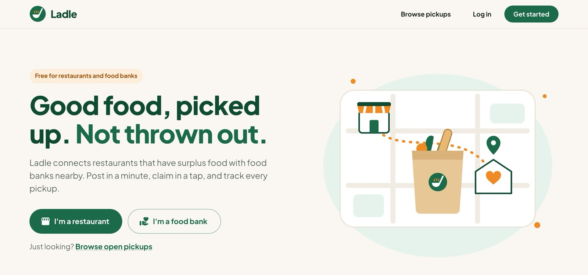

  <a href="#why-i-built-ladle">Why</a> ·
  <a href="#who-its-for">Who it's for</a> ·
  <a href="#what-you-can-do">Features</a> ·
  <a href="#a-tour-of-ladle">Tour</a> ·
  <a href="#try-the-demo">Try the demo</a> ·
  <a href="#running-locally">Run locally</a>

## Why I built Ladle

A friend of mine worked as a server at a restaurant. One day we were just talking, and he told me what happened at the end of every shift: whatever food was left over got thrown away. It wasn't spoiled. It just couldn't be kept and served the next day, because no restaurant wants to serve its customers stale food. So good food went in the bin, night after night.

At the same time, food banks are struggling to keep up with the number of people who need them. That's when the idea for Ladle came to me: the food one side throws away is exactly what the other side is short of. What was missing was an easy way to connect the two.

Ladle is that connection, and it's a win-win:

- **Food banks** get more good food to share with the people who rely on them, which helps ease hunger in the community.
- **Restaurants** stop throwing away food that's still good to eat, and can see the difference their donations make.
- **Volunteers** who want to help but don't work at either place can deliver food when a food bank has no vehicle.

Ladle is designed, built and maintained by **Dhairya Prajapati**. Development started in **February 2026** and is ongoing.

## Who it's for

| | What they get out of Ladle |
|---|---|
| **Restaurants, cafés and caterers** | A one-minute way to donate food instead of binning it, saved pickup locations so nothing has to be retyped, automatic weekly donations, and a record of everything donated. |
| **Food banks and community kitchens** | A live list and map of food nearby, filters for what they can actually accept and store, alerts when suitable food is posted, and a volunteer driver when they can't collect it themselves. |
| **Volunteer drivers** | Deliveries near them that fit their car and their schedule, with directions, handoff codes and contact details all on their phone. |
| **Admins** | A console to verify food banks, review deliveries that need a second look, and see activity across the platform. |

## How it works

1. **A restaurant posts surplus food:** what it is, how much, how it's stored, allergens, an optional photo, and when it can be picked up.
2. **Food banks nearby are alerted** if the food suits them. One food bank claims it, so there's never a double pickup.
3. **The food bank collects it,** or asks a volunteer driver to bring it. Handoff codes confirm the food really was picked up and dropped off.
4. **Everyone sees the impact:** the restaurant gets a donation record, and both sides build a track record of reliable pickups.

## What you can do

| Capability | How it helps |
|---|---|
| **Post food in about a minute** | Food types, quantity and weight, storage (room temperature, fridge, freezer, hot), when it was prepared, allergens and a photo. |
| **Saved pickup locations** | The restaurant's address is filled in on every post. A chain with several branches picks one, a one-off address (say, a catering event) still works, and each location can have directions for drivers. |
| **Weekly donations** | "Bread every Monday, Wednesday and Friday at 9 PM": Ladle posts it automatically on those days. |
| **Find food on a list and a map** | Search by distance, day, pickup time and food type, sort nearest first, and hide anything with allergens to avoid. |
| **Know what fits** | Food banks describe what they can accept (food types, fridge and freezer space, maximum weight, receiving days, travel radius). Every posting is labelled "Good fit" or says why not. |
| **Claim in a tap** | Only one food bank can claim a posting. Message the restaurant first if there are questions, or release the claim so someone else can take it. |
| **Volunteer drivers** | Food banks without a vehicle request a driver. Drivers get alerted to deliveries that suit them, accept one in a tap, and get directions to each stop. |
| **Proof of pickup and drop-off** | The restaurant and the food bank each show the driver a 4-digit code at the handoff. No code? The driver takes a photo instead and the food bank confirms it arrived. The driver's phone location is checked against each address, and only the result is kept. |
| **Works with no signal** | A pickup recorded in a basement loading dock is saved on the phone and sent when the signal returns, with the time it really happened. |
| **Reliability and ratings** | Restaurants confirm pickups or report no-shows, everyone can rate each other, and food banks and drivers build a visible track record. |
| **Impact and records** | Donations, kilograms rescued and estimated meals month by month, a CSV download, and a printable donation record for every pickup. |
| **Verified food banks** | Food banks add their charitable registration number and an admin verifies it, so restaurants see a verified badge. |
| **Notifications** | Under the bell, as browser and phone push notifications, and by email. |
| **Your data, your choice** | Download everything Ladle holds about you, or delete your account, from your profile. |

## A tour of Ladle

### 1. A restaurant posts its surplus

The restaurant's home page shows its weekly donations, everything it has posted and where each one is, with a map of its pickups.

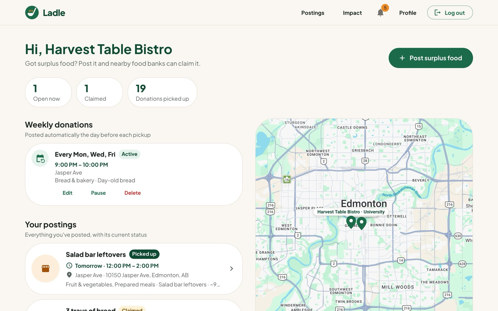

Posting takes about a minute. The pickup location is already filled in: a restaurant with one location just sees its address, and one with several branches taps the right one.

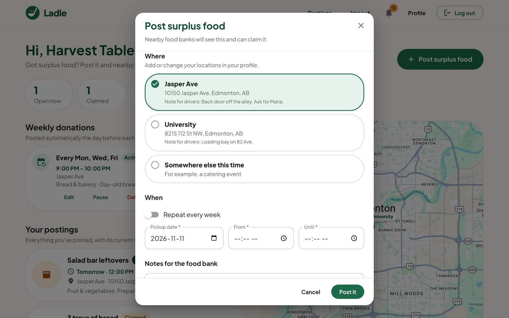

Locations are saved once on the profile, each with optional directions for whoever collects the food.

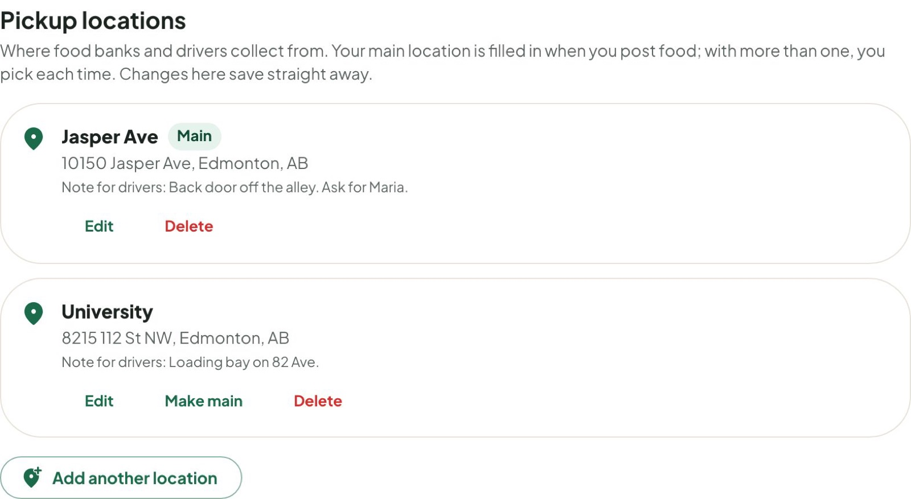

### 2. A food bank finds and claims it

Food banks see open pickups nearby on a list and a map, with distances and a "Good fit" label based on what they've said they can accept and store.

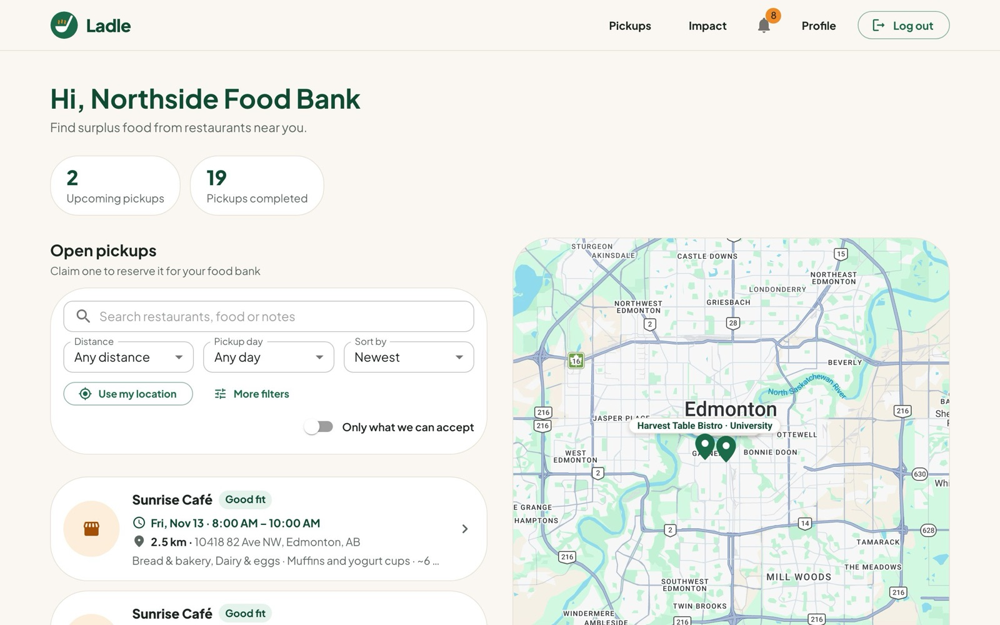

Each posting shows the pickup window, address and directions, food details, storage and allergens, a status tracker and a message thread with the restaurant. When a volunteer is delivering it, the food bank sees the driver's details and its drop-off code.

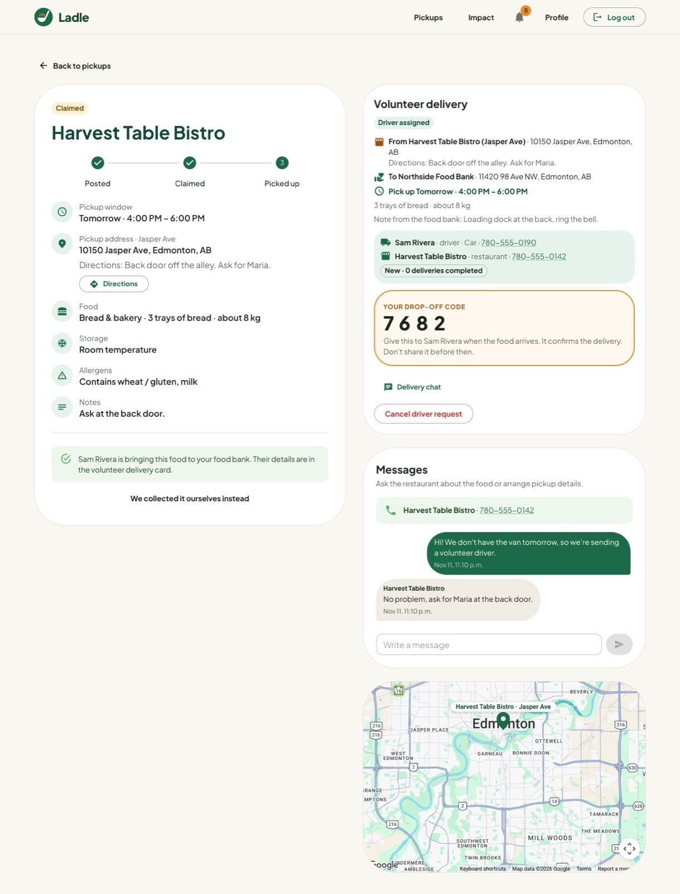

### 3. A volunteer driver delivers it

Drivers use Ladle on their phone. Each delivery shows where to collect, where to drop off, the restaurant's directions and one-tap navigation in Apple Maps or Google Maps. At each stop, the driver enters the code they're given, or takes a photo if there isn't one.

  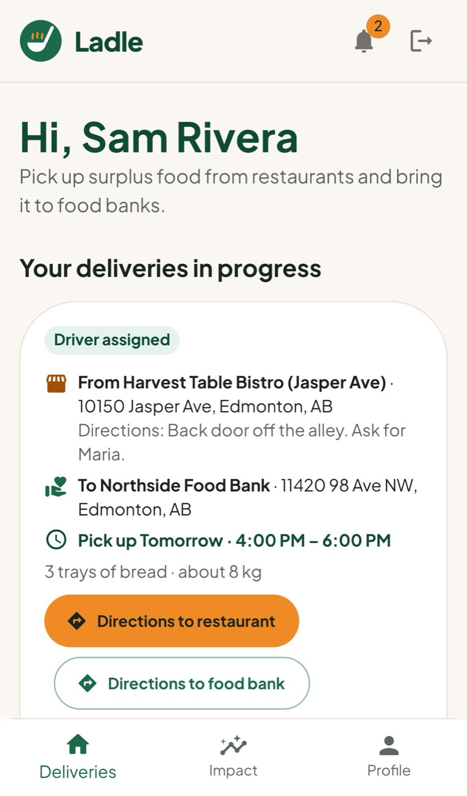
  &nbsp;&nbsp;
  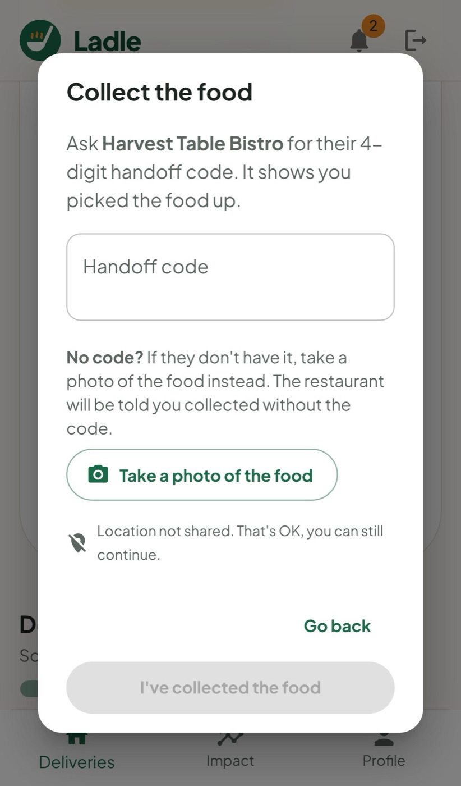

The restaurant sees its pickup code on the same posting, and gives it to the driver in person when the food is collected.

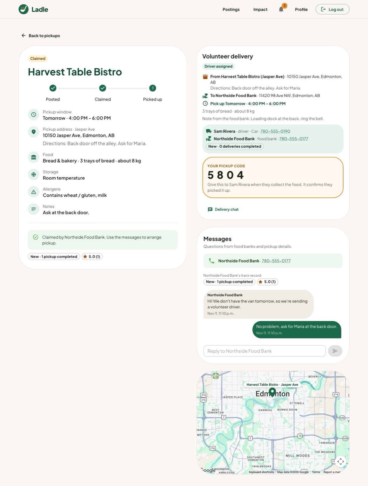

### 4. Everyone sees the impact

Restaurants see how much they've donated, month by month, and which food banks they've helped. Every pickup has a printable donation record for their own books.

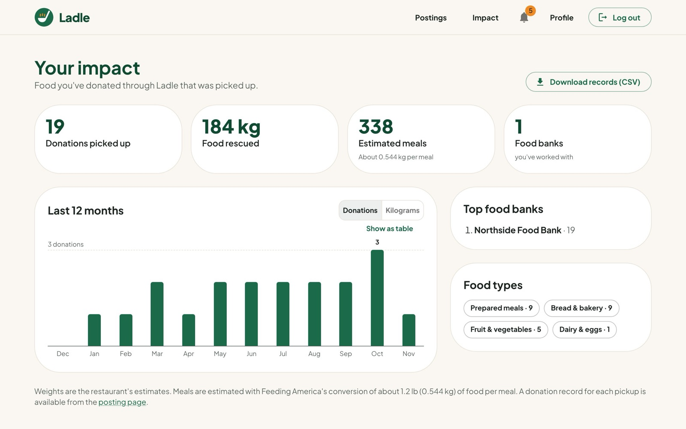

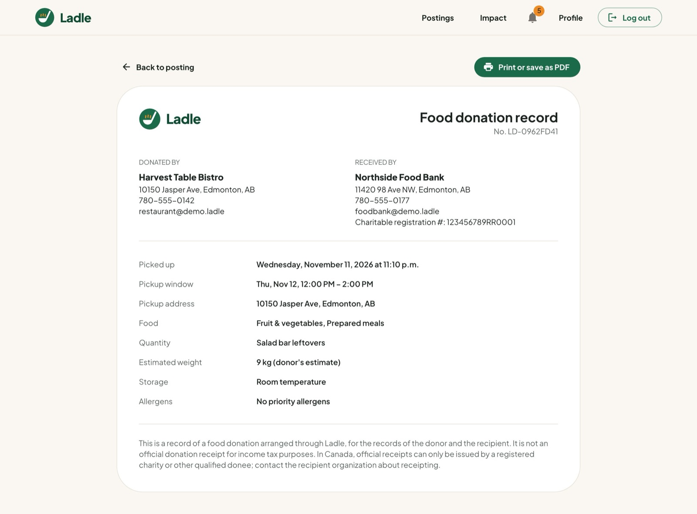

### 5. Admins keep it trustworthy

Admins verify food banks against the CRA charities listing, review deliveries that were disputed or looked wrong, and see activity across the platform.

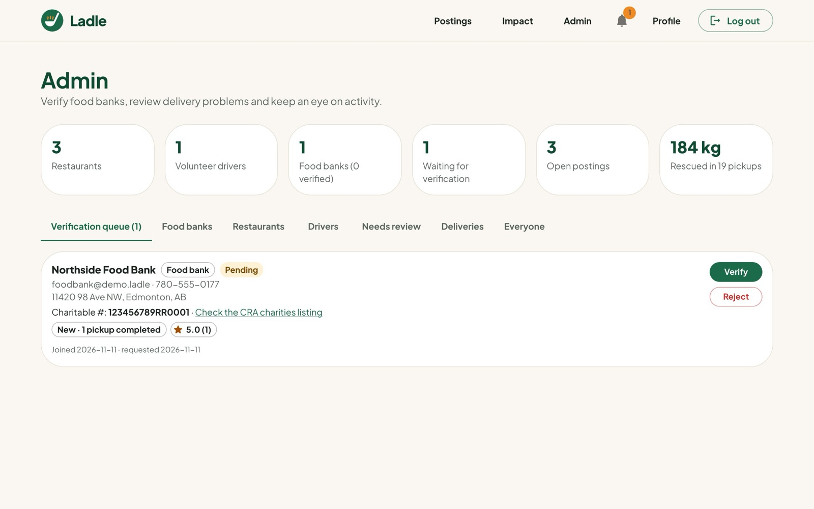

### Signing up

New users choose whether they're a restaurant, a food bank or a volunteer driver, and Ladle shapes everything after that around their role.

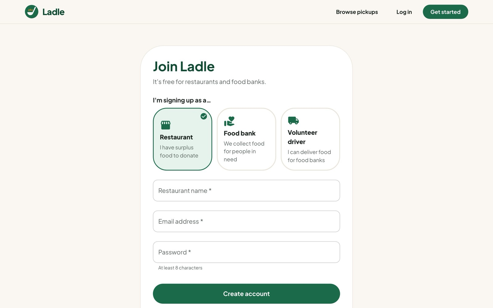

## Built for phones and tablets

Drivers use Ladle on their phones, and plenty of restaurants and food banks don't have a computer in the kitchen or warehouse, so Ladle is built mobile first:

- **Installable app (PWA)** with a bottom navigation bar on phones. iPhone and iPad users get step-by-step "Add to Home Screen" instructions, since Safari has no install button.
- **Finger-sized buttons** on touchscreens, and layouts checked on iPads in portrait and landscape.
- **Directions buttons** open Apple Maps on iPhone and iPad, and Google Maps everywhere else.
- **No signal? No problem.** Pickups and drop-offs are saved on the phone and sent when the connection returns.
- **Shared devices:** "Keep me signed in" can be unticked on a shared tablet, and any lost phone can be signed out from the profile.

## Trust, safety and privacy

- **Food safety:** the posting form asks for allergens and storage every time, and there's food safety and donor-protection guidance at `/food-safety`.
- **Accounts:** passwords are hashed with bcrypt, sessions use short-lived tokens in httpOnly cookies, and each role can only do what it should. For example, only restaurants post food and only food banks claim it.
- **Location:** a driver's position is used only to check they're at the address; Ladle keeps "near", "far" or "not shared", never the coordinates.
- **Privacy:** a privacy policy and terms of use (`/privacy`, `/terms`), a data download and account deletion. These pages are drafts and should be reviewed before launch.

## Built with

| Layer | Technologies |
|---|---|
| Client | React, Material UI, React Router, Vite, Google Maps JavaScript API |
| Server | Node.js, Express, MongoDB with Mongoose |
| Location | Google Geocoding, MongoDB geospatial queries |
| Photos | S3-compatible storage (Amazon S3, Cloudflare R2, Backblaze B2) |
| Notifications | Web Push (VAPID), email over SMTP |
| Installable app | Web app manifest and a service worker |
| Tests and CI | Node's test runner with Supertest and an in-memory MongoDB, Playwright browser tests on desktop, phone and iPad, GitHub Actions |

The design direction, competitor research and colour palette are in [docs/DESIGN.md](docs/DESIGN.md).

---

The sections below cover running, testing and configuring Ladle.

## Try the demo

Run the app with demo data, without a database or any keys:

1. `cd server && npm install && npm run demo`. This starts the API on http://localhost:5055 with an in-memory database, seeded with demo accounts for every role. Data resets each time it starts.
2. In another terminal: `cd client && npm install`, create `client/.env` with `REACT_APP_HOST_URL=http://localhost:5055/`, then `npm start` and open http://localhost:3000.
3. Log in with any demo account listed at the top of [`server/scripts/demo.js`](server/scripts/demo.js): a restaurant, a second restaurant, a food bank, a volunteer driver and an admin.

The demo places its addresses in Edmonton without calling Google, includes ten months of past donations so the impact pages have something to show, and prints emails to the terminal instead of sending them.

## Running locally

1. **Server:** copy `server/.env.example` to `server/.env` and fill in `MONGO_URI`, `JWT_ACCESS_SECRET` and `JWT_REFRESH_SECRET`. The server won't start without them. Then run `cd server && npm install && npm start`.
2. **Client:** create `client/.env` with `REACT_APP_HOST_URL=http://localhost:5000/` (keep the trailing slash; on macOS, port 5000 is often taken by AirPlay Receiver, so set `PORT=5055` in `server/.env` and use that port here) and `REACT_APP_GCP_KEY=<your Google Maps key>`. Then run `cd client && npm install && npm start` (Vite dev server on http://localhost:3000). `npm run build` writes the production bundle to `client/build/`, and `npm run lint` runs ESLint.
3. **Tests:** `cd server && npm test` runs the API test suite against an in-memory MongoDB (no database or keys needed). GitHub Actions runs the same tests, plus the client's lint and build, on every push and pull request (`.github/workflows/ci.yml`).
4. **Browser tests:** `cd e2e && npm install && npx playwright install chromium && npm test` starts demo mode and the client on spare ports and clicks through the main flows (posting, claiming, a volunteer delivery with photo handoffs and food bank confirmation, a pickup recorded with no signal, admin verification, password reset, phone layout, and iPad layouts with finger-sized buttons) in Chromium. CI runs these too.

### Optional server settings

| Variable | What it enables |
|---|---|
| `GOOGLE_MAPS_API_KEY` | Geocodes addresses when they're saved, for distance search, distances on cards and new-food alerts by radius. Restrict the key to the Geocoding API. |
| `S3_BUCKET`, `S3_ENDPOINT`, `S3_REGION`, `S3_ACCESS_KEY_ID`, `S3_SECRET_ACCESS_KEY` | Keeps food and handoff photos in an S3-compatible bucket (Amazon S3, Cloudflare R2, Backblaze B2) instead of the database. Keep the bucket private; Ladle serves the photos and checks who may see them. Without it, photos go to `server/uploads` in development and stay in MongoDB in production. After setting it up, run `npm run photos:move` once to move existing photos. |
| `SMTP_URL`, `EMAIL_FROM` | Emails notifications as well as showing them in the app. |
| `ADMIN_EMAILS` | Comma-separated emails of accounts that get the admin console (applied when they sign up or log in). |
| `REQUIRE_VERIFIED_TO_CLAIM` | `true` lets only verified food banks claim postings. Off by default. |
| `VAPID_PUBLIC_KEY`, `VAPID_PRIVATE_KEY`, `VAPID_SUBJECT` | Push notifications for the installed app. Generate a pair with `npm run vapid` in `server/`. |
| `TRUST_PROXY` | Behind a load balancer or proxy, the number of proxies (usually `1`), so login rate limits see real client addresses. |

In `client/.env`, set `REACT_APP_CONTACT_EMAIL` to the address shown on the privacy and terms pages.

Password reset emails need `SMTP_URL`. Without it, in development the reset link is printed in the server's console.

## Roadmap

- Route planning for drivers with more than one delivery.
- Partner programs: food banks that bring their own volunteer drivers.
- Team accounts, so each branch of a restaurant chain can have its own staff logins.

See [AUDIT_REPORT.md](AUDIT_REPORT.md) for the original audit, [docs/DESIGN.md](docs/DESIGN.md) for the design direction and [docs/UI_REVIEW.md](docs/UI_REVIEW.md) for the latest UI and accessibility review.
